# Online Store

A full-stack clothing store with a Laravel 13 API and a React 19 frontend: a searchable catalog with stock per size and color, sale prices, saved carts, coupons, a simulated card payment, PDF invoices, transactional email, reviews from verified buyers and a complete admin panel. The interface is in Polish. This is a portfolio project meant to run locally, and the whole stack starts in Docker with one script.

Want to see it without installing anything? Jump to the [interface preview](#interface-preview).

## Features

### Shop
- **Catalog**: Search, sorting, filters for price, size and color kept in the URL, pagination, and pages for new products and sale items
- **Product pages**: Photo gallery, stock shown per variant with unavailable combinations disabled, sale prices, related products
- **Cart**: Saved to the account and merged at login, with prices and stock always taken from the server
- **Checkout**: One page, for individuals and companies, with a separate delivery address, parcel locker selection, coupons and a free delivery threshold
- **Reviews**: Only customers who bought a product can review it, and ratings are calculated from those reviews
- **Wishlist**: Saved to the customer account
- **Newsletter**: Double opt-in, with an unsubscribe link in every message
- **Contact form**: Stored for the admin panel and sent to the shop address

### Orders and Payment
- **Simulated card payment**: A test payment screen with accepted and declined cards, and retries (see [Simulated Payment](#simulated-payment))
- **Status flow**: Pending, processing, shipped, delivered or cancelled, with the full history visible on each order
- **Stock handling**: Stock is taken in a locked transaction when an order is placed and returned when it is cancelled
- **Unpaid orders**: Cancelled automatically after 48 hours, so nobody can hold stock without paying
- **Invoices**: PDF invoices with net, VAT and gross amounts for paid orders
- **Email**: Order confirmations, status updates, password reset, newsletter confirmation and contact messages, sent through a queue

### Admin Panel
- **Overview**: Revenue, orders by status, low stock, unread messages and subscribers
- **Products**: Create and edit products, variants, stock, sale prices, new product flags and photos
- **Orders**: Filter by status, change status, confirm payments, download invoices
- **Customers, coupons and messages**: Search customers, manage coupons, read contact messages
- **Newsletter**: Subscriber list with a CSV export

### Technical Highlights
- **Server-side pricing**: One service calculates every total, so the browser never decides a price or a delivery cost
- **Safe stock editing**: Admin stock changes are applied as a difference, so sales made while the form is open stay counted
- **Image pipeline**: Uploads are checked by content, re-encoded and turned into 640 px thumbnails
- **Performance**: Route-level code splitting, with the admin panel in a separate chunk that shoppers never download
- **Accessibility**: Built to WCAG 2.2 AA, with keyboard flows and automated axe-core checks on every page
- **Docker setup**: The setup script finds free ports, generates secrets and keeps them between runs

## Technology Stack

| Area | Technology |
|------|------------|
| Backend | PHP 8.3, Laravel 13, Laravel Sanctum, DomPDF |
| Frontend | React 19, React Router 8, Vite 8, Tailwind CSS 4, lucide-react |
| Database | MySQL 8.4 |
| Infrastructure | Docker Compose, nginx, Apache, Mailpit |
| Testing | PHPUnit 12, Vitest, Testing Library, ESLint |

## Requirements

**[Docker Desktop](https://www.docker.com/products/docker-desktop/)**, or Docker Engine with Compose v2 on Linux, is all you need. PHP, Composer, Node.js and MySQL run inside containers.

Running without Docker needs PHP 8.3 with the `pdo_mysql`, `gd`, `exif`, `zip` and `bcmath` extensions, Composer, Node.js 22.22 or newer and MySQL 8.4.

## Quick Start with Docker (recommended)

```bash
git clone https://github.com/PiotrSmola/Online-Store-React-Laravel.git
cd Online-Store-React-Laravel
```

Then run the setup script:

| System | Command |
|--------|---------|
| Windows | Double-click `setup.cmd`, or run `powershell -ExecutionPolicy Bypass -File .\setup.ps1` |
| Linux, macOS, Git Bash | `./setup.sh` |

The script:

1. Checks that Docker is installed and running
2. Finds free ports: if a preferred port is taken, it uses the next free one and leaves whatever is running there alone
3. Generates a root `.env` file with the Laravel key, database passwords and admin password on the first run, and reuses it later
4. Builds the images, starts the containers, runs migrations, seeds the shop and creates the admin account
5. Waits until the shop responds, then prints the addresses and the admin login

| Service | Default port | Address |
|---------|--------------|---------|
| Shop | `8080` | http://localhost:8080 |
| API (localhost only) | `8000` | http://127.0.0.1:8000/api/products |
| Mailpit, the mail inbox (localhost only) | `8025` | http://127.0.0.1:8025 |
| MySQL (localhost only) | `3306` | `127.0.0.1:3306` |

The ports actually used are printed at the end and saved in `.env`. Preferred ports can be changed with `.\setup.ps1 -AppPort 3000` or `./setup.sh --app-port 3000`.

### Useful commands

```bash
docker compose ps               # container status
docker compose logs -f backend  # follow the Laravel logs
docker compose logs -f queue    # follow the mail worker
docker compose down             # stop the stack
docker compose down -v          # stop and delete the database and uploaded photos
```

Run the setup script again to rebuild after code changes. Your database and `.env` stay in place.

### Accounts and demo data

The admin account is created by the setup script, which keeps the generated password in `.env` and prints it at the end of every run. There is no default password. An admin signs in on the normal login page and finds the panel at `/admin`.

Demo customers exist only so that the shop has reviews and have random passwords. To shop, register a new account or place an order, which creates one.

| Coupon | Discount |
|--------|----------|
| `WITAJ10` | 10% |
| `MINUS20` | 20 zł on orders from 150 zł |

Delivery costs 15.99 zł by courier, 12.99 zł to a parcel locker and nothing for store pickup. Courier and locker delivery are free from 300 zł after the discount. Prices, lockers and invoice details are in `backend/config/shop.php`.

### Simulated Payment

There is no payment provider. The payment screen checks the card number in the browser and sends only the last four digits to the server, so no card number, expiry date or CVV ever reaches it.

| Card | Result |
|------|--------|
| `4242 4242 4242 4242` | Accepted: the order is paid and moves to processing |
| `4000 0000 0000 0002` | Declined, as is any card ending in `0002`: the payment can be retried |

Any future expiry date and any 3-digit CVV work. Bank transfers and cash are confirmed by an admin in the panel, and cash is available only with store pickup.

### Email

All mail goes to Mailpit, a local inbox that sends nothing to the outside world. Open it at the address printed by the setup script to read order confirmations, status updates, password reset links, newsletter confirmations and contact messages.

The shop contact details come from the `SHOP_CONTACT_*` variables in `.env`, and the defaults are fictional.

### Architecture

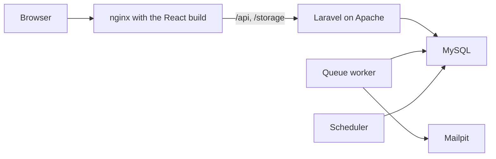

The browser talks to one origin, and nginx passes API calls and product images to Laravel. The queue worker sends mail. The scheduler cancels unpaid orders every hour and removes unconfirmed newsletter addresses every day. Uploaded photos and thumbnails live in the `product_images` volume, so they survive a rebuild.

## Manual Installation

### Backend

```bash
cd backend
composer install
cp .env.example .env
php artisan key:generate
```

Set `DB_DATABASE`, `DB_USERNAME`, `DB_PASSWORD`, `ADMIN_EMAIL` and `ADMIN_PASSWORD` in `.env`, then run:

```bash
php artisan migrate
php artisan shop:seed --local
php artisan shop:admin
php artisan shop:thumbnails
php artisan storage:link
php artisan serve
```

Mail is written to the log by default. To process queued jobs and scheduled tasks, run `php artisan queue:work` and `php artisan schedule:work` in separate terminals.

### Frontend

```bash
cd frontend
npm ci
npm run dev
```

The dev server talks to the API on `http://localhost:8000` unless `VITE_API_URL` says otherwise.

## Running Tests

Run the tests from a manual installation, because the Docker images contain no development packages.

```bash
cd backend
composer install
php artisan test   # always uses in-memory SQLite, never your database
```

```bash
cd frontend
npm ci
npm run lint
npm run test
npm run build
```

The backend has over 650 feature and unit tests covering orders, stock, payments, access control, uploads, email and invoices. The frontend has over 300 tests covering the cart, the API layer, forms and components.

## Security

- **Authentication**: Sanctum tokens that expire after 7 days, revoked on password change and reset
- **Access control**: Ownership checks on every order, invoice, cart, wishlist and review route, and all admin routes behind one middleware group, each covered by tests
- **Input handling**: Validation on every endpoint, whitelists for sorting and filtering, and bound parameters for all queries, including escaped search terms
- **Rate limits**: Login, registration, password reset, reviews, orders, contact form and newsletter, with password attempts limited per email and per account
- **Stock and payments**: Locked transactions, so an order cannot be paid twice and coupon limits cannot be passed
- **Uploads**: Checked by real content, re-encoded and stored under random names, with script execution blocked under `/storage`
- **Browser**: Content Security Policy and other security headers in nginx, no raw HTML rendering, and internal-only redirects after login
- **Privacy**: No card data on the server, no sensitive data in logs, IP addresses stored only as a keyed hash

Registration and checkout say when an email already has an account, so an address can be tested for registration. This is a deliberate trade-off: the person needs to know to log in instead, and rate limits slow down anyone probing addresses.

## Project Structure

```
backend/
  app/
    Console/Commands/   Seeding, admin account, thumbnails, scheduled tasks
    Http/Controllers/   Shop and admin API
    Mail/               Queued emails
    Models/             Eloquent models
    Services/           Pricing, orders, catalog, invoices, images, newsletter
  config/shop.php       Delivery, lockers, invoice details, contact details
  database/migrations/  Schema
  docs/api.md           API reference
  routes/               API routes and schedule
frontend/
  docker/               nginx configuration
  src/
    Components/Shop/    Shop pages
    Components/Admin/   Admin panel
    Components/ui/      Shared interface components
    Context/            Session, cart and toast state
    hooks/              Data hooks
    lib/                API client, formatting, cart and validation helpers
docker-compose.yml
setup.ps1, setup.sh, setup.cmd
```

## Database Structure

| Table | Holds |
|-------|-------|
| `products`, `product_variants`, `product_images` | Catalog, stock per size and color, photos |
| `customers` | Accounts, including the admin flag |
| `orders`, `order_items`, `order_status_events` | Orders, items with the price and name at purchase, status history |
| `cart_items`, `wishlist_items`, `reviews` | Data saved per customer |
| `coupons` | Discount codes and their limits |
| `newsletter_subscribers`, `contact_messages` | Subscribers with their confirmation state, messages from the contact form |

## API Endpoints

Every endpoint, with its request fields and response shape, is described in [backend/docs/api.md](backend/docs/api.md).

## Troubleshooting

**The stack does not start and the network is reported as overlapping**: The stack uses the subnet `10.213.47.0/24`. Change `DOCKER_SUBNET` and `FRONTEND_IP` together in `.env` and run the setup script again.

**A page shows no details about an error**: Debug pages are off by default. Set `APP_DEBUG=true` in `.env` and run the setup script again.

**Emails do not arrive**: Look in Mailpit, not in a real mailbox, and check the worker with `docker compose logs queue`.

**Signed out unexpectedly**: Tokens expire after 7 days, so sign in again.

## License

This project is released under the GNU General Public License v3.0. See [LICENSE](LICENSE).

## Interface Preview

Screenshots of the running application with demo data. Names, addresses and orders are fictional, and the interface is in Polish.

### Shop

| Home | Catalog with filters |
|------|----------------------|
| 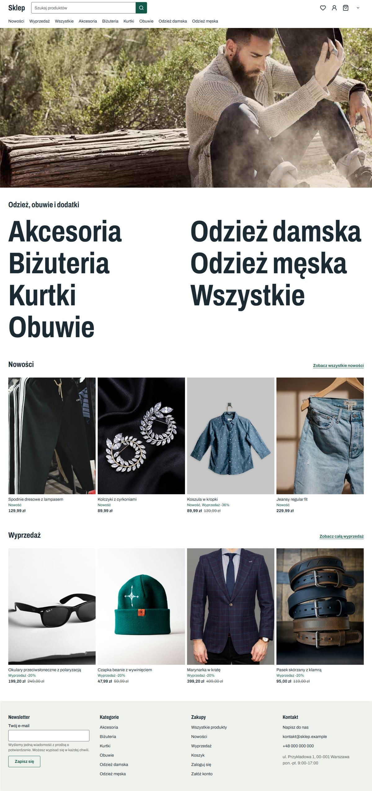 | 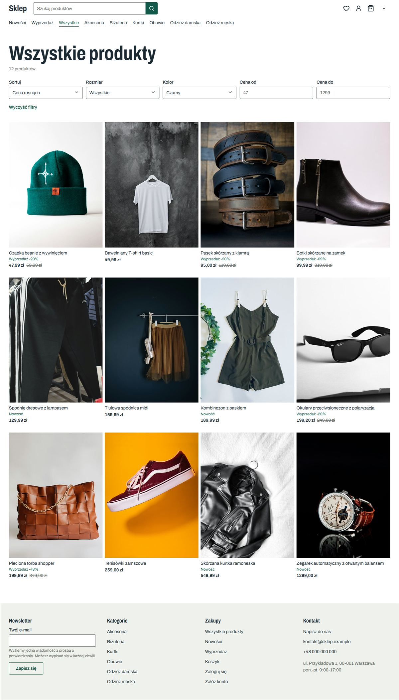 |

| Product on sale | Cart |
|-----------------|------|
| 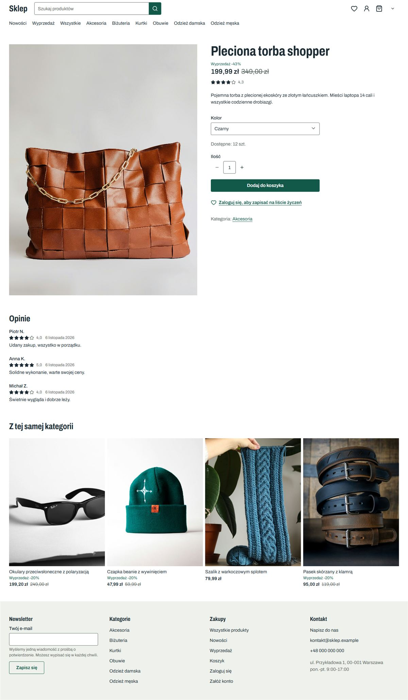 | 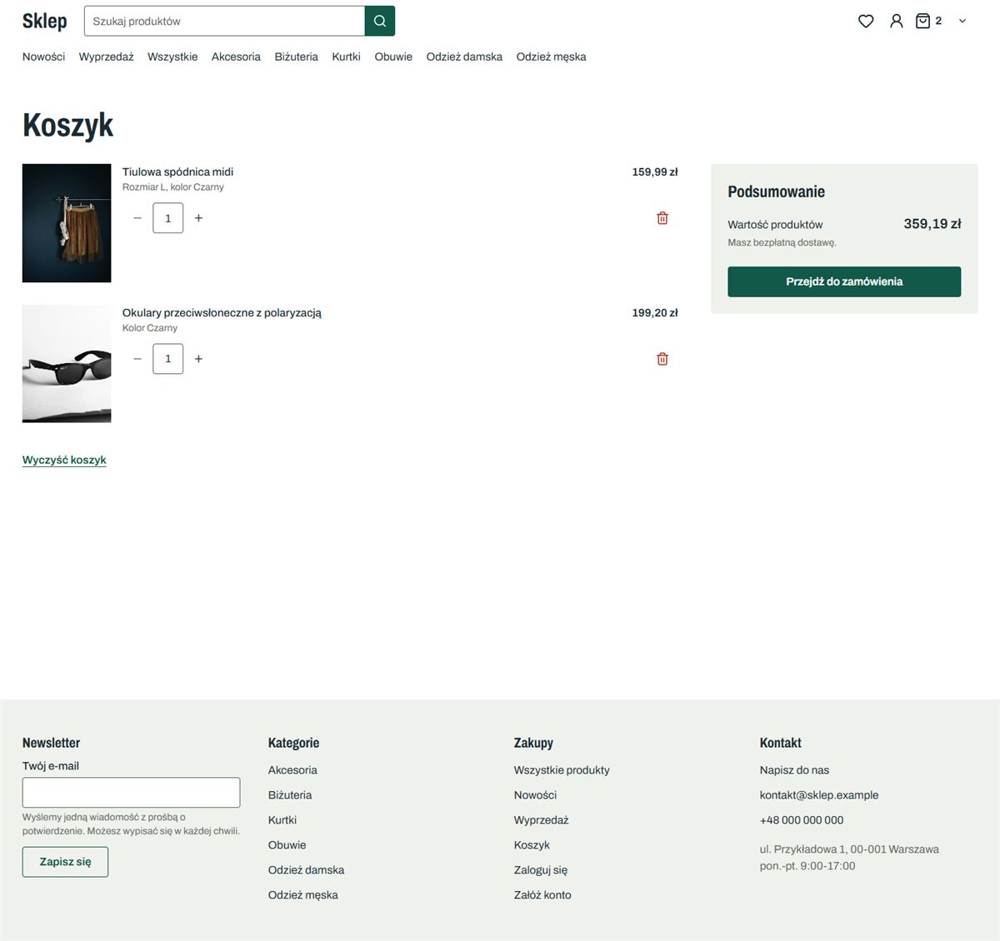 |

### Checkout and orders

| Checkout | Test payment |
|----------|--------------|
| 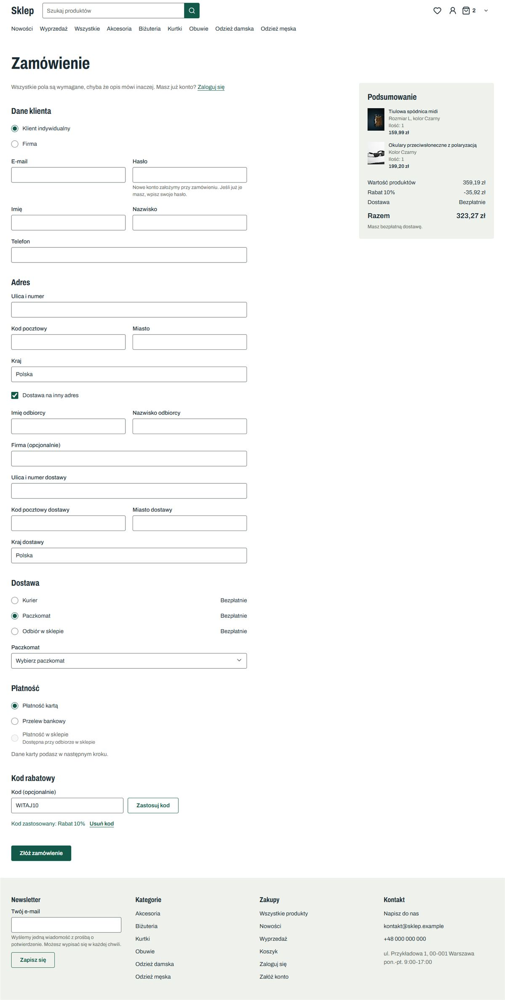 | 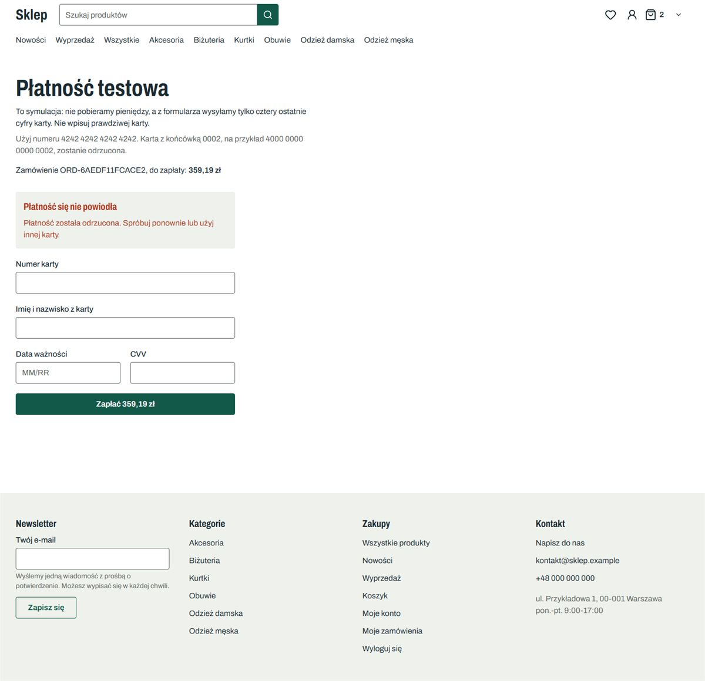 |

| Order with status history | Wishlist |
|---------------------------|----------|
| 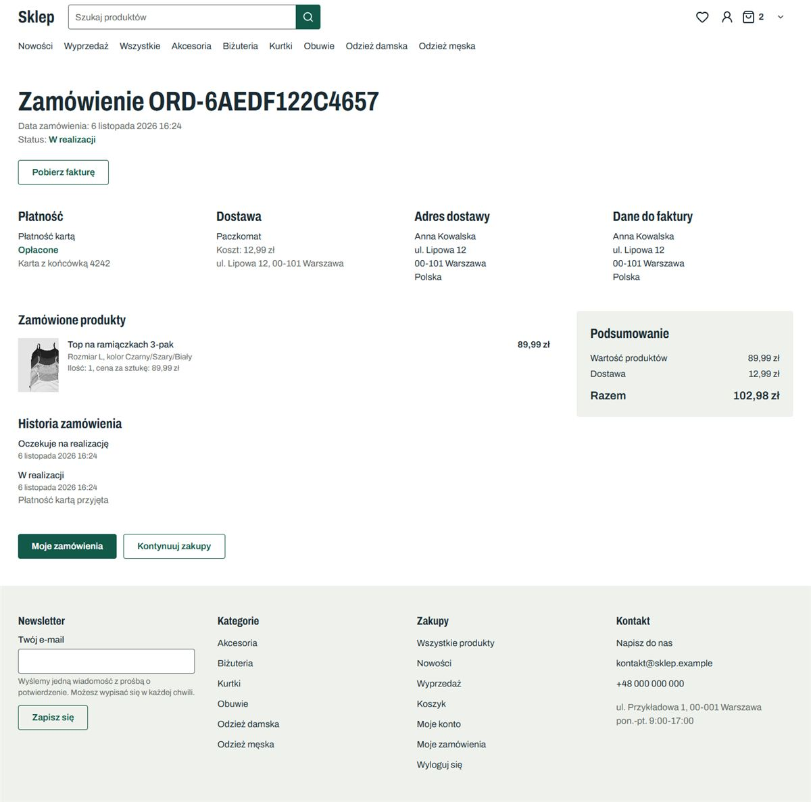 | 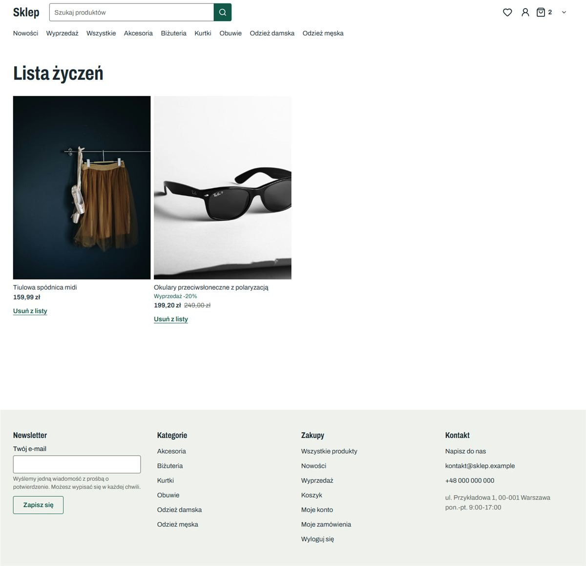 |

### Mobile

| Home | Product | Checkout |
|------|---------|----------|
|  | 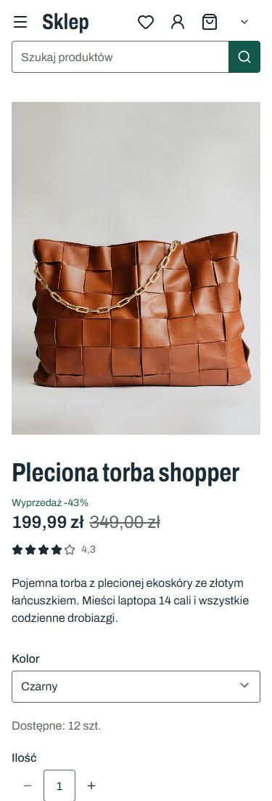 | 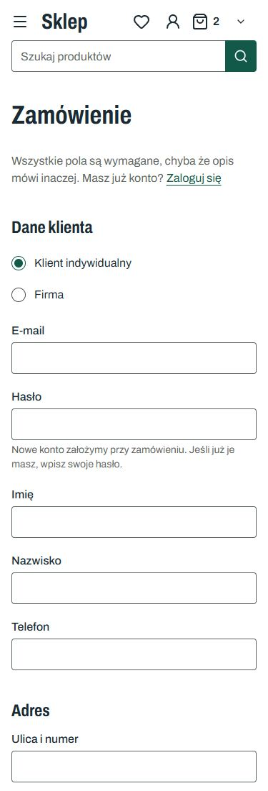 |
